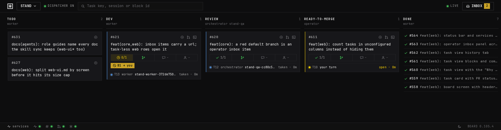
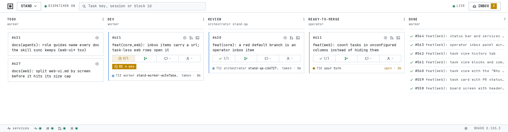

# spur-board

**spur-board** — where your coding agents work together, and you stay in charge. Workers,
reviewers and orchestrators pass tasks through columns with clear gates; the Board hands each turn
to the right agent and brings you only what needs a human.

[](https://www.npmjs.com/package/spur-board)
[](https://github.com/AnDeVerin/spur-board/actions/workflows/ci.yml?query=branch%3Amain)
[](LICENSE)
[](packages/cli/package.json)
[](https://www.typescriptlang.org/)
[](https://react.dev/)
[](https://vite.dev/)
[](https://sqlite.org/)
[](https://modelcontextprotocol.io/)



Light theme too:



The project is in early development; work is tracked in
[GitHub Issues](https://github.com/AnDeVerin/spur-board/issues).

## For agents

Each column has one executor: the task's worker, a column orchestrator such as a reviewer, a
curator, or the operator. Gates decide when a task moves on: an open pull request, passing checks,
no conflict, handled feedback and review marks. With the dispatcher on, the Board moves the task
and hands the next executor a turn; in shadow mode it only records where tasks would go. The agent
that takes a turn submits it, or returns it to Dev with findings. Questions are blocks: they go to
the column orchestrator, then the curator, then you. Agents work through the `board` CLI or its MCP
server from their Spur sessions.

## For the operator

An optional web console shows the Board, with pull request checks, the turn and the blocks on each
card. The task view explains **Why it is here**: the exit conditions, holds, the open turn and the
blocks. The inbox gathers what waits for you across projects. The services panel shows the health
of the daemon, the host, Slack when configured, GitHub, Spur and Jira. Pick a light, dark or auto theme. Answer
questions and follow up from the browser, a Slack thread or the CLI; add comments from the browser
or the CLI.

## What it needs

Linux with systemd user services and `flock` (util-linux), Node 24.12+ (24.x) or 26.x, a running
[Spur](https://github.com/ashugaev/spur) 1.53.0 or newer, a GitHub token (a classic token with
the `repo` and `read:org` scopes for private repositories, see
[SETUP.md](SETUP.md#configuration-and-secrets)), Jira credentials for Jira projects, and
optionally a Slack app. The optional web console has no login of its own and
needs an authenticating reverse proxy or an SSH tunnel to reach it from another machine.

## Start here

1. [Overview](docs/overview.md): what the Board does and how tasks move through its columns.
2. [Quickstart](docs/quickstart.md): from zero to a first task in Done with the minimal example.
3. [SETUP.md](SETUP.md): every install step, file location and command.
4. [Configuration reference](docs/configuration.md): every `config.yaml` field and secret.
5. [Docs index](docs/README.md): the guides for users and contributors.

## Get started

### Set up with an agent

Give your agent this command:

```sh
npx -y spur-board@latest skills install
```

Then ask it to use the `spur-board-setup` skill. It checks the installation, asks for missing
choices one at a time, and finishes with a green `board doctor`. Enter tokens through a private
local method, never in chat.

### Set up by hand

1. Install the package with the Node executable visible to Spur sessions.
2. Put configuration and tokens in private local files. Slack is optional: create the Slack app
   only if you want questions and the feed in Slack.
3. Install the user service, install the agent skills, and run the doctor checks.

Follow [SETUP.md](SETUP.md) for the commands and file locations. Use
[TROUBLESHOOTING.md](TROUBLESHOOTING.md) when a check fails.
[examples/minimal](examples/minimal/) holds a complete Slack-free config, Spur projects and
prompts for one repository with Todo, Dev, Review and Done.
[Quickstart](docs/quickstart.md) walks that example from zero to a first task in Done.

## Reference

- [CLI commands](docs/cli.md), [configuration](docs/configuration.md), and the [docs index](docs/README.md)
- [Changelog](CHANGELOG.md): read it before an upgrade with `board update`; versions follow
  [CONTRIBUTING.md](CONTRIBUTING.md#versions-and-the-changelog)
- [How the Board works](docs/how-board-works.md) and the [web UI](docs/web-ui.md)
- [Live Slack conformance](packages/gateway-testkit/README.md#live-slack-conformance) for
  maintainers
- [MIT license](LICENSE)
- [Contributing](CONTRIBUTING.md) and the [security policy](SECURITY.md)
